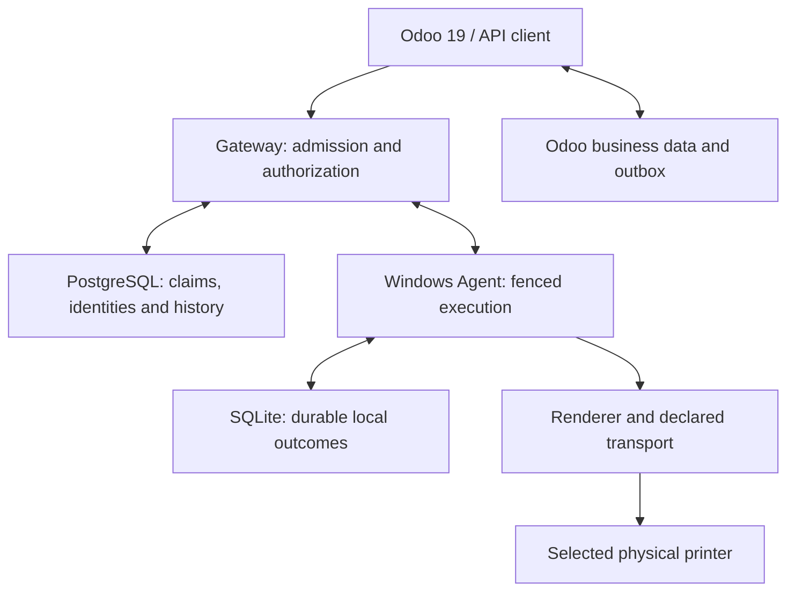
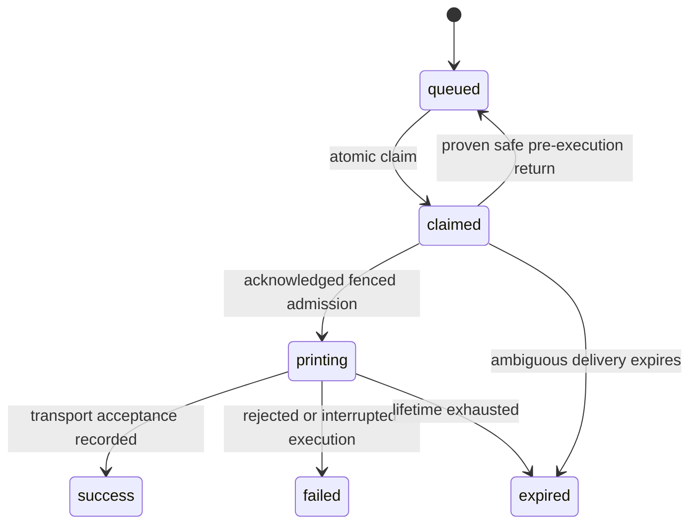

# Yaseir Cloud Printing Platform — Architecture

> **Addon version**: see `odoo_addons/print_gateway/__manifest__.py` | **Node**: 24.22.1 | **Go**: 1.26.10 | **Odoo**: 19 CE

## 1. System Overview

Yaseir Cloud Printing Platform is a multi-tenant SaaS platform that enables silent, hardware-level printing from Odoo ERP to physical printers through a three-tier distributed architecture.

### Ownership Boundary (Critical Design Decision)

| Concept | Owner | Rationale |
|---------|-------|-----------|
| Business records (orders, invoices) | Odoo | Odoo is the ERP system of record |
| Print intent & binding configuration | Odoo | Business context determines what prints where |
| Agent identity & lifecycle | Gateway | Runtime infrastructure concern |
| Printer inventory & status | Gateway | Agents report hardware state via heartbeat |
| Job queue & delivery guarantees | Gateway | At-least-once delivery with claim fencing |
| Physical print execution | Agent | Windows-local access to spooler/network/USB |

**Key prohibition**: The Gateway does NOT duplicate Odoo business models. It owns runtime infrastructure only.

## 2. Component Architecture

### 2.1 Central Gateway (Next.js + Custom Server)

**Location**: `src/`, `server.ts`

The Gateway is a Next.js application (dependency versions are pinned in `package.json` and `package-lock.json`) with a **custom HTTP server** (`server.ts`) that:
- Runs the Next.js request handler for API routes and dashboard UI
- Attaches a WebSocket server for real-time agent communication (`/api/agent/ws`)
- Runs periodic maintenance (job sweep, auth cleanup, agent presence sweep)
- Enforces trusted proxy authentication (Caddy → Gateway)
- Rejects known placeholder secrets in production mode

**API Route Structure** (route handlers under `src/app/api/`):
- `/api/agent/*` — Agent data plane (heartbeat, jobs, register, discovery)
- `/api/agents/*` — Agent management (CRUD, discovery sessions)
- `/api/odoo/*` — Odoo integration endpoints (agents, printers, keys, health)
- `/api/print/*` — Job submission and batch status
- `/api/printers/*` — Printer management and test operations
- `/api/auth/*` — Customer authentication (register, login, verify-email, etc.)
- `/api/billing/*` — Public catalog, workspace subscription status and owner-only commercial usage; retired provider mutations return HTTP 410
- `/api/subscription-requests` — Workspace-owner, tenant-scoped, idempotent subscription request/read; approval and activation require separate Platform Owner authority
- `/api/platform/*` — Platform administration, manual subscription grants and tenant lifecycle management
- `/api/admin/*` — Compatibility tenant-lifecycle endpoint with platform authorization
- `/api/team/*` — Tenant-scoped directory and invitation/acceptance flow; verified Platform Owner signed into the workspace can invite members with Full Access. Platform Admin invitations are retired; platform billing and cross-tenant administration remain separate.

### 2.2 Go Windows Agent

**Location**: `agent/`

A Go service designed for Windows deployment that:
- Connects to the Gateway via WebSocket with automatic reconnection (jittered exponential backoff)
- Falls back to HTTP polling when WebSocket is down (5s interval, safety poll every 30s when WS up)
- Sends heartbeats every 30s with full printer inventory and status
- Discovers printers via Windows Spooler API, network scanning, IPP discovery, and USB enumeration
- Executes print jobs with bounded concurrency (8 concurrent, 64 pending)
- Maintains a local SQLite queue for crash recovery
- Supports per-printer serialization to prevent concurrent physical prints

**Print Transports**: RAW TCP, ESC/POS, ZPL, TSPL, Windows Spooler, IPP/IPPS, Image rasterization

### 2.3 Tauri Desktop Manager

**Location**: `src-tauri/`, `src/desktop/`, `dist-desktop/`

A Tauri 2 desktop application for Windows that provides:
- Agent service management (start/stop/configure)
- Printer discovery and manual registration UI
- Pairing workflow (agent ↔ Gateway registration)
- Local printer test printing

### 2.4 Odoo 19 Addon (`print_gateway`)

**Location**: `odoo_addons/print_gateway/`

An Odoo 19 Community module that:
- Owns print bindings: maps (Company/Branch, Document Type, Destination) → (Gateway Agent, Gateway Printer)
- Intercepts `ir.actions.report` execution for silent PDF printing
- Registers an OWL report-action handler (`report_interceptor.js`) for defense-in-depth silent report interception
- Routes POS receipts and kitchen tickets as JPEG images
- Supports raw command routing (ZPL, TSPL, ESC/POS) with protocol enforcement
- Implements automated print policies with event-driven intent dispatch
- Provides diagnostic test page generation per printer protocol

## 3. Multi-Tenancy Architecture

### Model: Pool Tenancy

All tenants share a single PostgreSQL database with application-level tenant isolation via composite foreign keys.

**Isolation mechanism**: Every tenant-scoped table has a `tenant_id` column with:
- `NOT NULL` constraint
- Foreign key to `tenants(id)`
- Composite unique constraint: `UNIQUE(tenant_id, id)`
- Composite foreign keys between related tables (e.g., `printers(tenant_id, agent_id) → agents(tenant_id, id)`)

**Tenant lifecycle states**: `active` → `suspended` → `deleted`

**Auth gates**:
- `requireActiveTenant()` in `src/lib/tenant-guard.ts` — checks tenant lifecycle on every authenticated request
- Agent auth (`validateAgent()`) checks both agent lifecycle and tenant lifecycle
- Odoo API auth validates API key → tenant → active lifecycle chain

### Future Path (Documented, Not Implemented)

Pool → Bridge (schema-per-tenant) → Silo (DB-per-tenant) → Cells/Stamps

> **Note**: PostgreSQL RLS is NOT currently enabled. Tenant isolation relies on application-level `tenant_id` filtering in all queries. This is a documented architectural gap — RLS would provide defense-in-depth against query-level tenant leakage.

## 4. State Model

### Discovery synchronization
Discovered printer candidates are Gateway runtime observations owned by the Agent. Each Agent report carries a durable `identity_key`; repeated observations for the same Agent converge through the tenant+Agent+identity uniqueness boundary. Omitted devices are not automatically deleted from runtime inventory, and cancelled/failed/partial discovery sessions remain visible for reconciliation.

The system keeps the following state dimensions separate:

| Dimension | Values | Owner | Purpose |
|-----------|--------|-------|---------|
| **Lifecycle** | `active`, `disabled`, `retired` | Gateway DB | Administrative control |
| **Agent runtime** | `online`, `offline` | Gateway (via heartbeat) | Connection liveness |
| **Printer observation** | `online`, `offline`, `busy`, `error`, `unknown` | Agent observations persisted by Gateway | Device health evidence; freshness is evaluated separately |
| **Availability** | Computed from lifecycle + runtime + lastSeenAt | Gateway logic | Job routing eligibility |
| **Job status** | `queued`, `claimed`, `printing`, `success`, `failed`, `expired` | Gateway queue and claim-fenced Agent reports | Logical delivery/execution progress |
| **Physical outcome** | `not_printed`, `printed`, `unknown` | Derived from execution evidence | Whether physical output is proven; current transport success remains `unknown` |

`success` means completed transport submission, not proof of paper output. A `failed` or `expired` job carrying an unknown-outcome marker is physically uncertain. Never use the logical status alone to authorize a reprint. The canonical Gateway definitions are `src/lib/job-status.ts`; Odoo uses its own outbox statuses and maps Gateway results in `models/print_job.py`.

### Job Status Flow

A transition from a delivered or printing state to a terminal error carries the
physical-uncertainty marker where output may exist. It is never an automatic
transition back to a printable queue. Terminal acknowledgement replay updates
history using the original claim and operation identity; it does not create a
second physical attempt.

## 5. Security Architecture

### Authentication Layers

| Path | Mechanism |
|------|-----------|
| Agent → Gateway | Bearer token: `{agentId}:{secret}` with SHA-256 hash comparison (timing-safe) |
| Odoo → Gateway | API key (Bearer token) with SHA-256 hash lookup |
| Browser workspace → Gateway | V2 15-minute manager/customer access JWT, checked against a live refresh family and current tenant membership; opaque refresh-token hashes are stored in PostgreSQL. `manager_sessions` is the compatibility path for unexpired pre-v2 sessions. |
| Packaged desktop → Gateway | Paired Agent identity through the bundled Agent CLI; credentials remain outside the Tauri renderer |
| Customer → Gateway | Email/password with Argon2id hash; legacy scrypt hashes are upgraded on successful login, with email verification and rate limiting |
| Proxy → Gateway | `TRUST_PROXY_SECRET` header validation (≥32 chars, reject known placeholders) |

### Rate Limiting

- Auth rate limiting: per-key with lockout (`auth_rate_limits` table)
- WebSocket upgrade: per-IP rate limiting
- WebSocket messages: per-agent token bucket (20 capacity, 5/s refill)
- Print job admission: tenant plan entitlements and bounded Agent queue/in-flight limits

### Input Validation

- API input validation is endpoint-specific: structured request payloads use Zod schemas, while simple probes and fixed/primitive inputs use explicit type and length checks.
- Mutating `/api/*` requests require a valid `Content-Length`, are capped at 8 MiB, and reserve authenticated/unauthenticated concurrent-byte budgets until the response closes
- Print job payloads are validated against the shared `contracts/print-payload-contract.json` wire vocabulary. The database CHECK enforces the object/type/protocol subset; application validators enforce encoding, byte limits, signatures, and peripheral values. PDF data must begin with `%PDF-` and Gateway admission requires a `%%EOF` marker in the final 4 KiB
- Printer protocol/capability gating prevents incompatible job routing
- Diagnostic ZPL/TSPL/ESC/POS pages sanitize user-controlled names for their target command language

## 6. Database Architecture

### PostgreSQL + Drizzle ORM

**Schema**: 32 tables defined in `src/db/schema.ts`
**Migrations**: 101 forward-only migrations (`0000`–`0100`) in `drizzle/`
**Driver**: `pg` with connection pool; exact version is pinned in the Node manifests

### Key Design Patterns

1. **Composite ownership keys**: tenant-scoped registration IDs; discovery observations additionally include `agent_id`
2. **CHECK constraints**: Status enums enforced at database level (not just application)
3. **Idempotency keys**: Unique partial indexes for deduplication
4. **Claim fencing**: `claim_token` column prevents stale-claim processing
5. **Soft deletes**: Tenant lifecycle with `suspended_at`/`deleted_at` timestamps
6. **Audit events**: Full audit trail with actor type, action, resource references

## 7. Job Delivery Guarantees

The system implements bounded at-least-once delivery with claim fencing:

1. **Claim**: Gateway atomically claims a job with a unique `claim_token`; both `delivery_attempts < 5` and `retries < 5` must hold.
2. **Deliver**: Job is pushed to the agent by WebSocket or returned by HTTP polling. A hand-off consumes one delivery attempt.
3. **Evidence**: `delivered_at` records successful Gateway transport hand-off, while `acked_at` is recorded only after the Agent admits the job into its bounded local executor.
4. **Print**: Agent executes physical print and reports terminal status with the active claim token.
5. **Fence**: All status transitions are fenced by claim token — stale claims are rejected.
6. **Safe return**: A proven pre-execution rejection refunds its delivery attempt and consumes retry budget; ambiguous delivery is never retried freely.

**Stale claim sweep**: Every 30s, claims older than 90s with no delivery or acknowledgement evidence are requeued and consume retry budget. Delivered-but-silent claims and stale `printing` jobs become terminal failures with an unknown-physical-outcome marker for manual reconciliation.

## 8. WebSocket Architecture

The WebSocket server (`src/server/ws.ts`) implements:

- **Per-agent socket management**: Up to 8 concurrent sockets per agent (rolling reconnect)
- **PostgreSQL LISTEN/NOTIFY**: Real-time job dispatch across gateway instances
- **Agent reconnection**: Both rejected handshakes and lost sessions share 5/10/20/40/60-second retry steps with 50%–100% jitter and cancellation. A session must last at least 30 seconds to reset the budget; an accepted-then-closed connection cannot create a retry storm. HTTP polling continues during this delay.
- **Ping/pong keep-alive**: 30s server ping interval, 90s idle timeout
- **Back-pressure**: 1MB buffered-amount check before sending
- **Agent capacity fence**: Gateway claims at most 64 live claimed/printing jobs per Agent, matching the Agent local pending ceiling
- **Rate limiting**: Per-agent token bucket (prevents WebSocket abuse)

## 9. Deployment Architecture

### Production Stack

Public HTTPS terminates at Caddy. The private Gateway uses PostgreSQL 16 for
runtime state; site Agents establish outbound authenticated connections to the
Gateway. Printer traffic originates from the selected site's Agent.

- **Caddy**: Handles TLS termination, injects `TRUST_PROXY_SECRET` header
- **Docker**: `Dockerfile` for Gateway, `docker-compose.yml` for full stack
- **Multi-instance**: Multiple gateway instances supported via PostgreSQL LISTEN/NOTIFY

### CI/CD

The repository has separate CI, Docker, Windows installer, native-backport,
static-security, and security/supply-chain workflows. Their executable YAML files
under `.github/workflows/` are authoritative. Gates cover the locked dependency
graphs, TypeScript/build/regression checks, actual PostgreSQL migrations and
integration tests, Odoo installation/tests, Go race/vet, native source patches,
scanners and release artifacts. A successful cross-compile does not execute
Windows APIs or establish a signed installer acceptance result.

## 10. Time Authority & Clock Discipline

Print-job lifetime, presence, quota, and billing decisions are only correct if
every component measures time on the same clock. The platform therefore assigns
one authority per decision:

| Clock | Authority for | Notes |
| --- | --- | --- |
| PostgreSQL `now()` / `clock_timestamp()` | Every durable Gateway timestamp and every lifetime comparison | The single authority for job expiry, claim staleness, presence freshness, quota periods, and subscription periods |
| Database-calibrated Gateway clock (`src/lib/database-clock.ts`) | JavaScript decisions that mirror a SQL comparison | Retry-After arithmetic, agent/printer availability, subscription period gates |
| Odoo database clock (`db_now_utc`) | Odoo outbox claim/retry scheduling | `next_retry_at` deferrals are derived from the Gateway's relative `Retry-After`, never from an absolute Gateway timestamp |
| Windows Agent monotonic clock | Local dispatch/backoff/timeouts | Ownership freshness is measured only with monotonic deltas; the Agent never compares a Gateway timestamp with its own wall clock |

**Rules**

1. A JS process never compares a database timestamp with the raw host
   clock. `gatewayNowMs()` / `gatewayNow()` return host time plus the measured
   database offset (recalibrated at most every 30s, with the round-trip midpoint
   removed and a 2s timeout; on failure the last known offset is kept, so the
   default is plain host time and availability never depends on the database).
2. Every write that will later be compared by SQL uses the database clock:
   presence (`agents.last_seen_at`, `printers.last_seen_at`), job lifetime
   (`created_at`, `updated_at`, `expires_at`), and quota/subscription periods.
3. Job enqueue reads the database clock exactly once and derives both
   `expires_at` and `created_at` from that single reading, so a job's stored TTL
   equals the requested TTL even inside a long transaction. Migration 0067 moves
   the `print_jobs` defaults from `now()` (transaction start) to
   `clock_timestamp()` (wall clock) for every other writer.
4. Durations, not instants, cross system boundaries: the Gateway returns
   `Retry-After` seconds computed on its own clock, and Odoo/Agent apply them to
   their own clock.
5. Manager/platform sessions and tenant-selection tokens use PostgreSQL time for
   their signed `iat`/`exp` values and session-expiry predicates. Host wall-clock
   time is not an authority for authentication validity; cleanup predicates also
   use database time.

**Enforcement**: `tests/database-clock.test.ts` (unit, behaviour and source
contracts) and `tests/database-clock.integration.test.ts` (live calibration,
single-reading TTL invariant, quota rollback).

Manual subscriptions are changed by authorized Platform Admin operations.
`print_monthly_usage` counts the current UTC calendar month's jobs independently
of monthly, yearly or custom contract dates. Provider timestamps and identifiers
remain historical evidence; retired provider routes cannot grant or renew a
subscription or reset consumed credits.

New physical dispatch requires an acknowledged, claim-fenced `printing` response (`success: true`, `status: "printing"`). Local delivery receipt age is diagnostic only; a buffered frame may already have a stale claim. An unacknowledged admission sends no hardware bytes. Printing that already crossed this boundary retains its durable outcome reporting through a later disconnect. Repeated admission for the same live printing claim is acknowledged without creating another job or physical attempt.

Gateway document-type displays and admission share the pure `validatePayloadForPrinter` implementation in `src/lib/printer-capability.ts`, re-exported by routing. Explicit supported_protocols remain authoritative, and physical backend restrictions still override unsupported image/PDF capabilities. The Go capability matrix remains the matching Agent authority.

## 11. Measured printer capabilities and image geometry

The V3 wire authority is `contracts/printer-geometry-contract.json`, with shared
positive and negative fixtures consumed by TypeScript, Go and Odoo. The existing
`printers.capabilities` and `printers.config` JSON columns carry observations and
desired configuration; this printer change does not require a new SQL migration.

| Field / boundary | Meaning and owner |
| --- | --- |
| `capabilities.geometry.version` | Version 1 of the common measurement contract |
| `source` / `validation` | `windows_driver` or `ipp` observations are `observed`; an explicit operator profile is `validated_profile` / `configured` |
| `printer_id` | Exact Agent execution ID, matching the Gateway printer row; aliases require a fresh observation using the adopted ID |
| `observed_at` | Observation timestamp; freshness and desired-state convergence remain separate checks |
| `config_fingerprint` | Agent-generated SHA-256 over the destination binding, protocol, measurements and driver/media observation identity; timestamps and credentials are excluded |
| `printable_width_dots` | Required measured or explicitly configured printable width; nominal 58/80 mm labels cannot supply it |
| Optional dimensions | Actual paper dimensions, printable height, offsets and horizontal/vertical DPI when known; omitted values remain unknown |
| `raster_command` | `gs_v_0` only when explicitly validated for the selected ESC/POS device |
| `config.geometry_profile` | Manager/operator supplied measurements; the Agent validates them before emitting a configured observation |
| Image `geometry_fingerprint` | Immutable reference to the geometry used to render that image |

Windows observations use the current printer/driver/port identity, full DEVMODE
and actual device-context `PHYSICALWIDTH`, `PHYSICALHEIGHT`, `HORZRES`, `VERTRES`,
`PHYSICALOFFSETX/Y`, and `LOGPIXELSX/Y`. Physical paper and printable bounds remain
distinct. The native path rechecks the actual context before `StartDoc`; a stale
image geometry cannot silently shrink to a smaller newly selected printhead.

IPP queries request actual media, media collections, default/ready media,
resolutions, raster types, scaling and document formats. Collection parsing is
bounded by the 64 KiB response budget, eight nesting levels, typed dimensions and
margins, and explicit member/value limits. Supported media and margins are
published under `ipp_capabilities`; a failed or older concurrent probe cannot
refresh stale observations. Geometry is published only when a selected media and
its real margins establish an unambiguous printable area. Non-integral DPI
converted from dpcm is not misreported as integral observed DPI in the v1 profile.

When a real IPP response supplies `printer-uuid`, the Agent pins that printer
service identity to its execution binding. The first successful observation is
persisted before a print preflight can finish, including a print started before
the first heartbeat. A changed or disappearing established UUID blocks physical
submission and invalidates fresh media/geometry observations. Restarting the
Agent or refreshing discovery cannot silently replace that binding. An endpoint
that has never advertised a UUID remains explicitly without that identity proof;
the UUID is a service continuity signal, not cryptographic device attestation.

Manager changes clear the old geometry. The Gateway exposes geometry for a
managed printer after its desired revision, applied revision and observed
configuration converge. An ID alias or changed known destination/protocol cannot
rebind someone else's old geometry. Timestamp-only refreshes preserve discovery
approval; changed measurements, origin, binding or fingerprints invalidate it.
The existing manager printer-details UI accepts validated profiles; paired
Desktop credentials do not gain manager mutation permissions.

### Image generation and physical rendering

Odoo obtains the selected route's current geometry before rendering a POS,
kitchen or Sales Details receipt. CSS layout uses printable dots and actual DPI
to preserve physical typography: CSS width is `dots × 96 / dpi_x`; raster scale
uses the actual axis DPI. It does not use a 512-dot default or cap valid widths at
576. A direct raster layout can derive printable millimetres from dots and DPI;
turning an image into a physical PDF page additionally requires real paper width.
Missing geometry, missing image/font resources, invalid canvas output and
excessive raster dimensions fail before a print operation is enqueued.

The JPEG image ceilings remain 16,384 pixels on either axis, 40 million decoded
pixels and the shared encoded-byte limit. A long receipt within these bounds is
not reduced to fit a page height. A document beyond a security/resource ceiling
fails explicitly; the limit is not bypassed by an unadvertised lower DPI.

New Gateway image admission locks the selected printer row and requires a
matching fingerprint. The Agent validates it again at execution. An already
accepted idempotent operation is reconciled with its original payload, even if
its geometry is now old or the legacy payload had no fingerprint. That recovery
path does not authorize a new image job without current geometry.
Odoo performs this exact durable replay lookup after current record, company and
route authorization and before checking new live geometry. It returns the saved
outcome without resetting the operation or making another outbound submission;
a different payload, fingerprint, source or route cannot reuse the old operation.

| Transport | Input and behavior |
| --- | --- |
| Windows local/shared/USB-backed driver queue | PDF through the embedded PDFium/GDI path; JPEG requires physical geometry. Receipt pages preserve printable width and paginate vertically within the selected driver form and bitmap budget. Per-axis output DPI and nonprintable offsets are retained. |
| Direct USB or TCP ESC/POS | Explicit protocol plus measured width and validated `gs_v_0` authorize JPEG-to-raster conversion. Rows are segmented with bounded buffers. A protocol label alone never authorizes a raster command. |
| IPP/IPPS | PDF input only. Real PDFium metadata establishes each page size before submission. A matching advertised fixed/custom media is selected; unknown or mixed media requires a supported driver path. Native PDF is preferred when advertised; otherwise advertised PWG Raster or single-page JPEG may be prepared on Windows. |
| ZPL/TSPL and explicit RAW | Declared byte-language passthrough only; they are not generic PDF/image renderers and an inferred printer class cannot enable them. |

IPP sends `ipp-attribute-fidelity=true`, the selected media/known margins,
advertised resolution where applicable, and `print-scaling=none` when advertised.
An advertised orientation may authorize landscape selection. Missing PWG
resolution/type never becomes a 300-DPI/gray default. JPEG raster density is chosen
from the advertised square resolutions; it is not silently lowered to fit the
bitmap ceiling. Preparation may choose a different independently advertised
format before transmission, but only one `Print-Job` is sent. An ignored or
substituted strict attribute response is an unknown physical outcome, not a
successful exact-geometry claim and not permission to resend.

The software does not promise compatibility with every driver, arbitrary label
language, IPP implementation or raster variant. Device-specific paper limits,
spooler behavior, physical margins, actual QR/barcode readability, USB interfaces,
service permissions and transport completion still require the retained Windows
and physical-printer acceptance gates. The detailed supported and blocked matrix
is delivered with the V3 printer compatibility report.

## 12. Shutdown, security and release evidence

The custom HTTP and WebSocket serializers share the security-header policy,
including refusals, malformed upgrade responses and successful upgrades. HTML
responses retain nonce-based CSP; the bounded CSP report collector logs only
allowlisted report fields. COOP is `same-origin`; no COEP isolation claim is made.
Password-only login and recent password confirmation replace the removed factor
flows; current membership/owner authorization and live session-family checks
remain mandatory.

Accepted maintenance, WebSocket acknowledgement, registration, notification and
dispatch work is tracked and drained before the database pool closes. An abort,
timeout, transport failure or lost acknowledgement does not erase durable claim
and uncertainty evidence. The production runtime database role can append/read
audit events but cannot update or delete them; migration postconditions recheck
that privilege boundary. Deployment-owner access and protected external log
custody remain distinct operational controls.

HTTP policy refusals, WebSocket handshake refusals and central Manager
permission denials emit a fixed-schema security event. The process-wide monitor
retains 120 detailed events per minute and aggregates excess counts by a bounded
surface/status set, flushing them on the minute boundary and graceful shutdown.
It never accepts URLs, request content or credentials as log fields. This
operational stream does not replace protected external log custody or claim
complete upstream/native authorization-event coverage.

An interrupted physical attempt always remains uncertain. The deprecated
`reprint_after_crash` configuration is accepted for configuration compatibility
but cannot authorize another attempt, even when explicitly true. The local
ledger, Agent recovery and Gateway status transition each enforce this boundary.
Only work known not to have crossed the execution boundary may retry normally;
an operator must reconcile an uncertain result before authorizing a separate new
operation.

Verification records distinguish actual PostgreSQL, PDFium, Chromium, native
Linux builds and loopback protocol exchanges from simulated Agent/device work.
The final workload must run against a frozen source inventory after printer
changes, with less-compressible representative payloads and recorded tail
latency, memory, queues and recovery outcomes. Neither simulated submission nor
a previous source revision's test result is physical printer acceptance.
